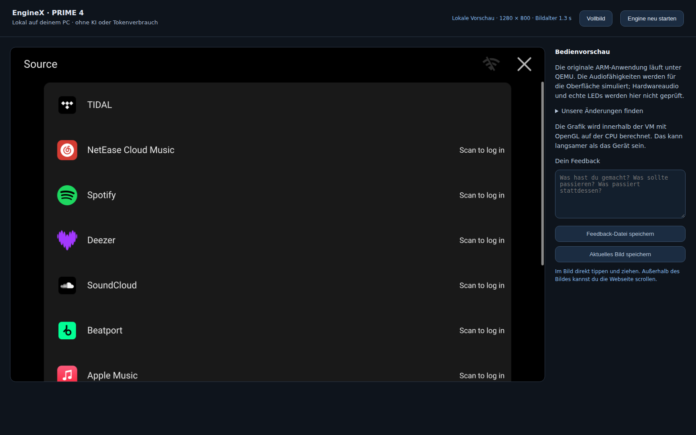
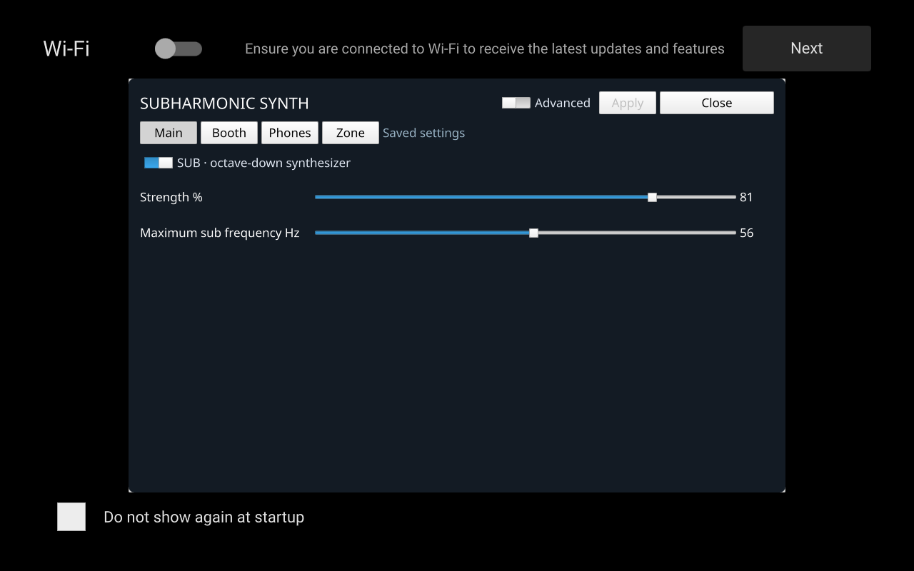

# Local PRIME 4 browser preview (experimental)

This branch runs the original PRIME 4 JC11 ARM Engine application using QEMU
inside a separate Linux virtual machine. Open it locally in a browser to try
the EngineX menus and the optional Output Equalizer, Subharmonic Synthesizer
and steady-button-LED Mods. No AI model, API key, subscription or token usage
is involved in running or operating the preview.
The three Mods are installed and initially enabled only in this VM's private
preview data; you can change their enabled state there.

The preview is for UI feedback. It does **not** emulate the PRIME 4 hardware,
bootloader, audio converters, physical controls or LEDs. It cannot certify
brick resistance, audio quality, hardware timing or a successful device reboot.
The equalizer and synth use simulated audio capabilities for their controls;
no audio is produced. The original application uses Qt's OpenGL scene graph
with Mesa rendering on the VM's CPU. This renders custom geometry and shader
effects which the simpler Qt raster backend omitted. It can respond slowly;
the host GPU is not passed into the VM.

The preview captures the completed OpenGL render pass and encodes its PNG on
the VM's native x86 CPU. It avoids a second ARM render pass and ARM PNG
compression. Browser input coalesces waiting drag positions while preserving
press/release ordering. The displayed image age describes capture/transport
freshness; it is not a measurement of audio or physical-device latency.



## Start on Linux

The launcher currently supports Linux x86_64, including Ubuntu. Allow about
4 GB of VM memory and several GB of free disk space (the virtual disk can grow
up to 24 GB). KVM acceleration is used when `/dev/kvm` is accessible; otherwise
QEMU falls back to slower software emulation. Installing the VM dependencies
requires the usual local administrator password once:

```sh
sudo apt install qemu-system-x86 qemu-utils cloud-image-utils git
git clone --single-branch --branch feature/desktop-preview https://github.com/Sebluu/EngineX-OS.git EngineX-OS-preview
cd EngineX-OS-preview
python3 tools/preview/launch.py
```

The launcher opens <http://127.0.0.1:8765> once the local viewer is ready.
The first start downloads a checksum-pinned Ubuntu cloud image, the stock
PRIME 4 firmware, published EngineX baseline and build dependencies. The VM compiles the preview
tools from the checked-out commit. This initial preparation takes substantially
longer than later starts; watch progress with a second terminal:

```sh
python3 tools/preview/launch.py logs
```

Use the mouse to click and drag the Engine screen, and click inside the image
before typing. Skip Wi-Fi/account setup; this preview's Engine process has no
internet or LAN access. Access EQ and synth through Engine's mixer settings.
On a touchscreen, tap and drag directly inside the image. Gestures there belong
to Engine; scrolling the surrounding page remains available outside it. The
current bridge supports one active finger. Press Fullscreen for more space.
The browser's **Engine neu starten** button restarts only the application.
The settings and Mod state remain in the VM's private data directory.

This branch includes the combined `test/all-features` changes. Close onboarding
with its X, then swipe down from Engine's top toolbar (or use its gear icon) to
open Control Center and Settings. Open **Settings → Mixer → Output Equalizer → Open** or
**Settings → Mixer → Subharmonic Synthesizer → Open**. The 3 kHz band and the
10 Hz–22 kHz response graph are in Output Equalizer. Select Main, Booth, Phones
or Zone, then use Apply to save. PRIME 4 Steady LEDs is included and initially
enabled; the browser has no physical controller LEDs to display its effect.
Updating an existing preview also upgrades its original EQ/SUB Mod packages
to 0.1.1 through the Mod manager, retaining their enabled state and profiles.



Stop with **Ctrl+C** in the launch terminal, or:

```sh
python3 tools/preview/launch.py stop
```

Use **Feedback-Datei speichern** for a local JSON file containing your note,
source commit, display information and numeric DSP profiles. Screenshots are
downloaded separately. Neither button uploads anything; attach the files when
you want to share feedback. Feedback exports omit account files, credentials,
music titles and raw logs. The note and any screenshot contain what you choose
to enter or display.

## Isolation and data

Only generated VM files are connected to QEMU. The launcher never passes host
disks, USB controllers, audio interfaces, folders or a connected deck into it.
The browser port listens on host loopback only. The VM has network access for
setup; the extracted Engine root runs in a separate mount, PID and network
namespace with only loopback, a small device whitelist and blocked updater,
reboot and firmware-writing entry points. No image is repacked or installed.
The copied root is marked as a desktop preview and the preview plugin/backend
refuse to activate without that marker. They are never packaged in a Mod or
firmware image.

VM files are stored under `${XDG_CACHE_HOME:-~/.cache}/enginex-preview`.
Use `--directory /some/private/directory` for another instance, `--port 9001`
for a different loopback port, `--memory 3072` or `--cpus 2` for fewer resources,
and `--no-browser` to open the URL yourself. Supply the same directory and port
when using `stop` or `logs`. Do not delete the VM disk while QEMU is running.
Each VM is pinned to its source commit and browser port. After stopping the VM,
update its source and reuse its downloaded images and private settings with:

```sh
git pull --ff-only
python3 tools/preview/launch.py update
```

Supply the same `--directory` and `--port` used for the initial start. The
update rebuilds the preview inside the existing VM; its settings and Mod state
are retained. The source is verified before the guest service is stopped and
replaced. Use a fresh `--directory` to keep an independent copy of an older
preview instead. The ordinary `start` action rejects a changed source pin.

## Verification scope

The preview workflow builds against public Qt 6 headers, tests browser-server
boundaries and boots the actual ARM Engine from the pinned copied root. Its
input smoke test injects an explicitly CI-only QML target into that process and
requires a captured image plus acknowledgments from real pointer and keyboard
events. It also requires OpenGL and a custom scene-graph triangle in the actual
Engine image, so the incomplete raster renderer cannot pass. Those synthetic
targets are never included in the interactive preview.
These checks do not replace testing an actual PRIME 4.

The complete Linux VM setup was also exercised from a fresh disk, including
the browser HTTP interface, feedback export, application restart, clean VM
shutdown and a second boot. The upgrade test starts with the previously
installed OpenGL preview
(`394efce`), retains non-default DSP settings on the same disk, installs the
new capture pipeline and performs another full shutdown and ordinary start.
Screenshots
wait for the application UI rather than accepting the startup splash, and
navigation skips Wi-Fi/profile setup to capture the library/onboarding view.
The browser check sends real Chrome touch events, verifies that gestures inside
the image do not scroll the page and that scrolling outside still works, and
requires a touch to change an actual Engine control. The native Engine test
opens both optional DSP panels and waits for their SDK settings, complete
delegates and stable positions. It rejects the old small SUB slider touch
areas, then drags the real strength slider and taps its current Apply button
position, requiring the value to be saved through the SDK.

[Touch, Mod controls, persistence and VM upgrade verification](https://github.com/Sebluu/EngineX-OS/actions/runs/45467140293)
